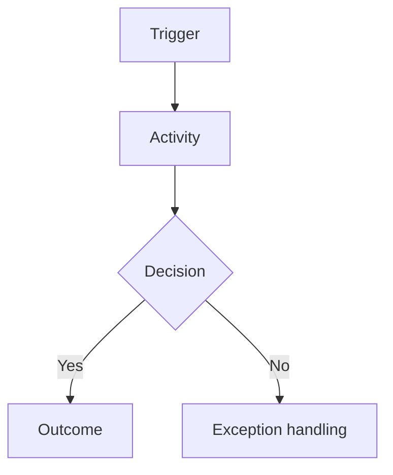

# Business Process

```yaml
document_id: BUSINESS_PROCESS
project: [PROJECT_NAME]
version: 1.0
document_status: Draft
owner: [OWNER]
last_updated: YYYY-MM-DD
source_commit: [COMMIT_OR_UNKNOWN]
```

## 1. Process identity
- Process ID:
- Process owner:
- Trigger:
- Outcome:

## 2. Current state (AS-IS)
[Actors, steps, systems, handoffs, delays, controls, exceptions.]

## 3. Target state (TO-BE)
[Desired flow and rationale.]

## 4. Process diagram


## 5. Rules and controls
| Rule ID | Rule | Enforced by | Evidence |
|---|---|---|---|

## 6. Exceptions and failure paths
[Alternate paths, recovery, escalation.]

## 7. Requirements and acceptance
[Link FR IDs, use cases, and test cases.]
