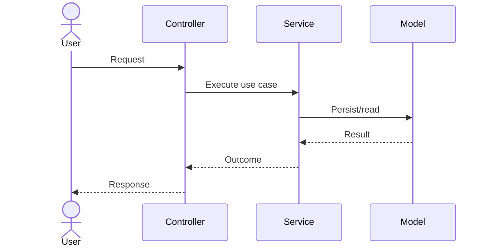

# Component Architecture

```yaml
document_id: COMPONENT_ARCHITECTURE
project: [PROJECT_NAME]
version: 1.0
document_status: Draft
owner: [OWNER]
last_updated: YYYY-MM-DD
source_commit: [COMMIT_OR_UNKNOWN]
```

## 1. Scope
[Module/component boundary and responsibilities.]

## 2. Component inventory
| Component | Responsibility | Owns business rules? | Depends on |
|---|---|---|---|

## 3. Dependency rules
[Allowed direction, forbidden dependencies, shared contracts.]

## 4. Interaction diagrams


## 5. Transactions and side effects
[Transaction boundaries, after-commit events, queues, external calls.]

## 6. Error and authorization boundaries
[Where checks occur and how failures are mapped.]

## 7. Testing and change impact
[Unit/feature/integration tests and dependent components.]
