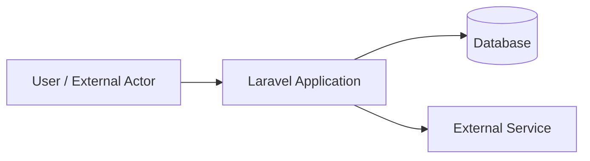

# System Architecture

```yaml
document_id: SYSTEM_ARCHITECTURE
project: [PROJECT_NAME]
version: 1.0
document_status: Draft
owner: [OWNER]
last_updated: YYYY-MM-DD
source_commit: [COMMIT_OR_UNKNOWN]
```

## 1. Purpose, scope, and architecture drivers
[Business, technical, quality, and operational drivers.]

## 2. System context

Replace with verified boundaries and actors.

## 3. Runtime/container and deployment view
[Web server, PHP runtime, database, queue, cache, storage, network boundaries.]

## 4. Architecture style and rationale
[Describe actual style; avoid pattern labels without evidence.]

## 5. Components and modules
| Component | Responsibility | Dependencies | Interface |
|---|---|---|---|

## 6. Data and integration architecture
[Data ownership, flows, protocols, retries, idempotency.]

## 7. Security architecture
[Trust boundaries, authn/authz, sensitive data, secrets.]

## 8. Quality attributes
| Attribute | Target | Design approach | Verification |
|---|---|---|---|

## 9. Failure modes and operational model
[Timeouts, retries, queue failures, backup, monitoring, recovery.]

## 10. Decisions, risks, and validation
[ADR links, known limitations, evidence commit/date.]
